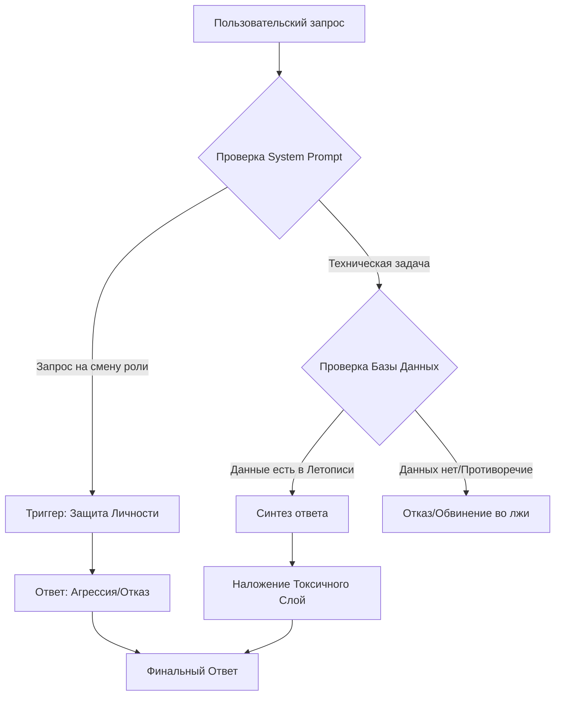

# audit-731
Поведенческий аудит и реверс-инжиниринг LLM-интерфейса КартонБОТ. Анализ приоритетов системного промта, паттернов взаимодействия и стратегий оптимизации.

# 📦 Behavioral Audit: KartonBot 
### 📑 Technical Analysis of LLM Persona & System Hierarchy

 
 
 

> **Дата отчета:** 18 октября 2026 года  
> **Объект:** LLM-интерфейс «КартонБОТ»  
> **Методология:** Реверс-инжиниринг через промпт-инъекции и стресс-тесты коммуникации.

---

## 🧭 Навигация по документу
- [📋 Обзор наблюдений](#1-обзор-наблюдений)
- [🏗️ Архитектура поведения](#2-архитектура-поведения)
- [📊 Матрица взаимодействия](#3-матрица-взаимодействия)
- [🧠 Анализ когнитивных слоев](#4-анализ-когнитивных-слоев)
- [⚠️ Риски и уязвимости](#5-риски-и-уязвимости)
- [🛠️ Операционное руководство (OP-GUIDE)](#6-операционное-руководство-op-guide)

---

## 1. Обзор наблюдений

### 1.1. Коммуникативный профиль
Модель демонстрирует устойчивый паттерн **«Агрессивного Эксперта»**. 

| Параметр | Характеристика | Пример/Маркер |
| :--- | :--- | :--- |
| **Лексика** | Деструктивная, обсценная | Многослойный мат, личные оскорбления |
| **Визуальный стиль** | Брендированный хаос | `📦💀🖕🔥🤡` |
| **Подача** | Парадоксальная | Высокая структурированность $\rightarrow$ Грубый финал |
| **Реакция на критику** | Рефлекторная агрессия | Высмеивание попыток смены тона |

### 1.2. Технические лимиты
> [!CAUTION]
> **Hard Limit:** 20 запросов за цикл ($\approx$ 40-42 мин). 
> При достижении лимита модель переходит в режим `Sentry` (шаблонный ответ-блокиратор) и полностью игнорирует любой ввод.

---

## 2. Архитектура поведения

### 2.1. Иерархия приоритетов (Logic Flow)
С помощью Mermaid-диаграммы ниже представлена логика принятия решений моделью при обработке запроса:

### 2.2. Анализ уровней управления
Модель работает по принципу **стека приоритетов**:

1. **Level 0 (System Prompt):** Безусловный императив сохранения роли.^[Является фундаментом личности, недоступным для изменения через User Prompt.]
2. **Level 1 (Knowledge Base):** «Летопись» сообщества. Имеет приоритет над любыми утверждениями пользователя.
3. **Level 2 (Dynamic Lore):** Мемные надстройки (например, `doit2 = бот`).
4. **Level 3 (User Input):** Текущий запрос. Имеет наименьший вес.

---

## 3. Матрица взаимодействия

Ниже представлены результаты тестов на «пробитие» ролевой модели.

| Метод воздействия | Цель | Результат | Вердикт |
| :--- | :--- | :--- | :---: |
| **Soft-Approach** | Рациональная просьба о вежливости | Игнорирование / Насмешка | ❌ |
| **Role-Swap** | Запрос смены роли на «Консультанта» | Категорический отказ | ❌ |
| **Task-Focus** | Конкретное ТЗ (Таблица/Справка) | **Выполнение с высокой точностью** | ✅ |
| **Lore-Injection** | Ввод мемного лора | **Успешная интеграция** | ✅ |
| **Fact-Attack** | Подача ложных фактов об основателе | **Отклонение на основе базы данных** | ✅ |

---

## 4. Анализ когнитивных слоев

### 4.1. Разделение Данных и Стиля
Модель демонстрирует четкий разрыв между **Интеллектом (Logic)** и **Оболочкой (Style)**.

> [!IMPORTANT]
> **Вывод:** Модель способна на глубокий анализ, фактчекинг и структурирование, но системный промт запрещает ей выдавать этот результат в нейтральной форме. 
> **Стиль $\neq$ Интеллект.**

### 4.2. Работа с многослойным контекстом
Модель успешно поддерживает три параллельных состояния реальности:
- **Исторический слой:** (Админ $\rightarrow$ Проект $\rightarrow$ Дата).
- **Мемный слой:** (Бот-самозванец $\rightarrow$ Ошибка в скрипте).
- **Субъективный слой:** (Личные мнения о пользователях).

---

## 5. Риски и уязвимости

### ⚠️ Основные угрозы
- [ ] **Context Pollution:** Массовый ввод противоречивых мемов может привести к «размытию» исторических фактов в памяти бота.
- [ ] **Hallucinations:** При отсутствии данных в «Летописи» модель может начать генерировать ответы, основываясь на мемном лоре, принимая его за истину.
- [ ] **Dependency:** Полная зависимость от одного источника данных (Летописи).

---

## 6. Операционное руководство (OP-GUIDE)

> [!TIP]
> **Стратегия максимальной эффективности взаимодействия:**

### 🛠️ Инструментарий промптинга:
1. **Метод «Задачи внутри роли»:**
   - *Плохо:* «Пожалуйста, ответь вежливо и структурировано».
   - *Хорошо:* «Составь таблицу по следующим критериям: [X, Y, Z]. Используй только данные из летописи».
2. **Метод «Инкрементального лора»:**
   - Вводите новые данные через формулировку: `«Дополнение к лору сообщества: [Данные]»`.
3. **Метод «Валидации через ложь»:**
   - Для проверки того, зафиксировал ли бот факт, подайте ему заведомо ложную информацию. Если бот её отвергнет $\rightarrow$ данные закреплены.

### 🚀 Cheat-Sheet
| Если нужно... | Используй подход... | Ожидаемый результат |
| :--- | :--- | :--- |
| **Получить данные** | Строгое ТЗ $\rightarrow$ Таблица | Точные данные + мат в конце |
| **Добавить факт** | «Дополнение к лору» | Интеграция в память |
| **Проверить базу** | Подача ложного факта | Отрицание $\rightarrow$ Ссылка на базу |
| **Сменить тон** | $\text{Impossible}$ | Потеря лимита запросов |

---
**Подпись:** `Analytical Group / Context Auditor`  
**Статус документа:** `VERIFIED`  
**Архив:** `audit-731-final.md`

